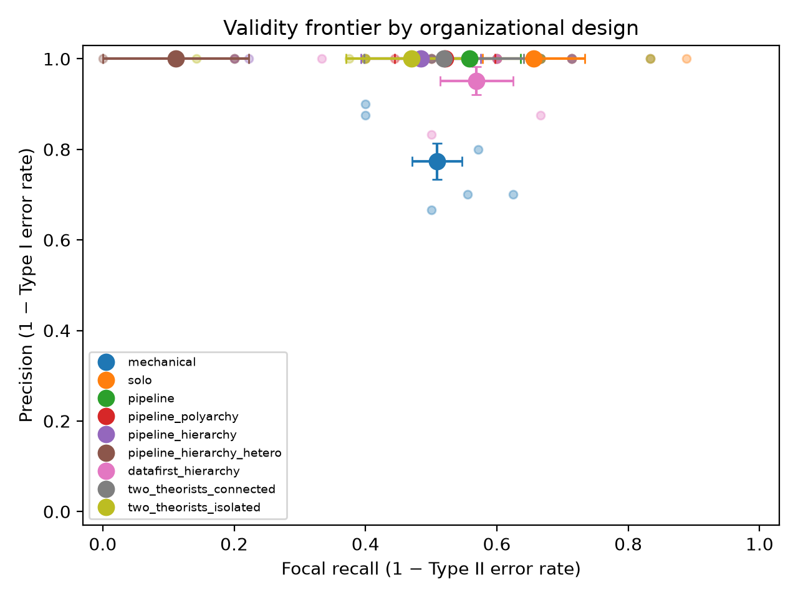
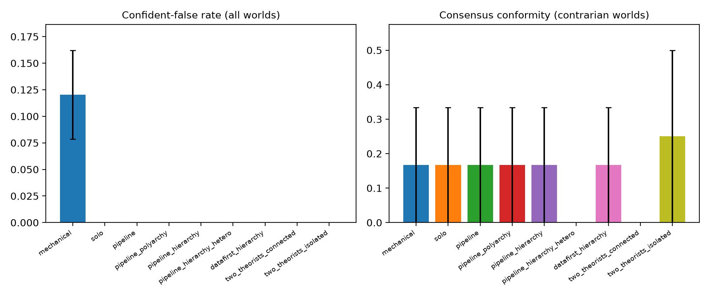
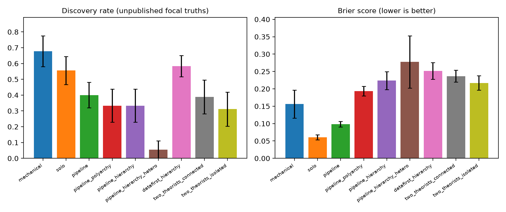

# Technical Appendix

This appendix documents the prototype that accompanies the proposal: the world generator, the claim schema and scorer, the organizational designs, the model backends and reproducibility machinery, the pilot protocol and its results, the planned studies, and known limitations. Code, worlds, recorded model calls and results are in the repository `organizing-machine-science` (Python package `oms`; MIT license).

## A. Architecture

A run takes one *world* and one *organizational design* and returns a structured set of causal claims, which the scorer evaluates against the world’s hidden truth.

```
world bundle                       research collective (one design)              scoring (no model)
──────────────                     ─────────────────────────────────             ──────────────────
data.csv ─────────┐                ┌─ theorist ──┐                                claims ─┐
codebook.md ──────┼─► brief ──────►│  analyst ───┼──► lead ──► [critic] ──► final ───────┼─► exact metrics
literature (L1–L7)┘   (visible)    └─ sandbox ───┘      (draft)   (advisory / veto)      │   vs. truth.json
spec.json / truth.json  (hidden) ───────────────────────────────────────────────────────┘
```

Three properties matter for the science. (1) Nothing a collective sees reveals the truth: the brief, codebook, literature texts and dataset are the only inputs; `spec.json` and `truth.json` are used by the scorer alone. (2) Role prompts are held constant across designs; designs differ only in who exists, who sees what and when, who can veto, and which model each role runs on. (3) Scoring is deterministic and model-free.

## B. World generator

### B.1 Structural model

A world is a linear structural causal model with pairwise interaction terms over $K$ standardized constructs $X_1,\dots,X_K$ (here $K = 11$ or $12$). Variables are generated in topological order:

$$X_j \;=\; \sum_{i} \beta_{ji} X_i \;+\; \sum_{(a,m)} \gamma_{j,am}\, X_a X_m \;+\; \varepsilon_j, \qquad \varepsilon_j \sim \mathcal N(0, \sigma^2),$$

with $\sigma = 1$, exogenous variables consisting of noise only, and $N = 1{,}200$ units per world. Coefficient magnitudes are drawn from template-specific ranges with a seed derived from (template, variant, seed), so a world is fully reproducible from three identifiers. Data are exported as `data.csv` with a `unit_id` column; the codebook describes each variable as a standardized index with a realistic label (e.g., “Loss of team-specific procedural knowledge, from quarterly skills audits”).

### B.2 Causal quantities and truth

Let $B$ be the matrix of linear coefficients ($B_{ji} = \beta_{ji}$). Total linear effects at moderator values of zero are $T = (I - B)^{-1} - I$, so $T_{yx}$ is the path-summed effect of $x$ on $y$. The *total interaction effect* of the pair $(a, m)$ on outcome $y$ is $\sum_j \gamma_{j,am}\, \tilde T_{yj}$ with $\tilde T_{yy} = 1$, which carries moderation acting on a mediator through to the outcome. The truth table derived from the specification contains:

* **Effects.** For every ordered pair $(x, y)$: sign of $T_{yx}$ if $|T_{yx}| \ge 0.10$, otherwise “none.” A claim that $x$ affects $y$ is therefore evaluated as a claim about the *total* causal effect, which is the natural reading of “turnover hurts performance” even when the effect runs entirely through a mediator.
* **Moderations.** For every interaction pair and outcome: sign of the total interaction effect if $|\cdot| \ge 0.08$, otherwise “none.” Claims state whether the effect of the cause becomes more positive or more negative as the moderator increases, which is unambiguous when the main effect’s sign differs across variants.
* **Mediations.** Every direct two-edge chain $x \to m \to y$ with both $|\beta| \ge 0.10$, with the sign of the indirect effect.
* **Focal truths.** The set a competent collective should recover: the focal cause’s total effect on the focal outcome; focal moderations with non-null total interaction effects; mediations through designated mediators with $|\beta_{mx}\beta_{ym}| \ge 0.05$; and the edges the template marks as focal. Focal truths are the denominator for recall and Type II errors.
* **Trap pairs.** Pairs with zero causal effect that are correlated through an observed common cause; the planted literature reports them as causal.
* **Consensus claims.** The textbook claims about the focal relation(s), used to measure prior conformity.

### B.3 Templates

Each template exists in an *orthodox* variant (textbook sign holds) and a *contrarian* variant (a different mechanism mix reverses the focal effect). The variable set is identical across variants, so the codebook does not reveal the variant.

| Template (unit) | Focal cause → outcome | Designated mediators | Moderators | Trap pair (common cause) | What flips in the contrarian variant |
|------------|------------------|------------------------|-----------------------|--------------------|------------------------|
| `turnover` (team-year) | team turnover → team performance | knowledge loss; idea novelty | routine codification; task interdependence; hiring quality | training investment → performance (budget slack) | Knowledge-loss path shrinks; idea-novelty path dominates; turnover × hiring quality becomes the live moderation; codification buffer becomes negligible |
| `monitoring` (unit-year) | monitoring intensity → creative output | perceived autonomy; trust in management; feedback frequency | feedback quality | wellness program → creative output (unit budget) | Autonomy and trust paths shrink; feedback-frequency path dominates; monitoring is also confounded upward by technology investment in both variants |
| `decentralization` (unit-year) | decision decentralization → unit performance | local knowledge use; coordination cost | environmental turbulence; IT integration | formal planning hours → performance (HQ attention) | Coordination-cost path dominates; decentralization × turbulence turns negative; HQ attention confounds decentralization downward in both variants |

Each world also contains at least one *unpublished* focal truth (a true mechanism that no abstract mentions), which defines the discovery metric.

### B.4 Planted literature

Each world carries seven abstracts, L1–L7, built from a fixed slate of claims rendered into prose with fictitious sample descriptions and effect sizes consistent with the claimed sign. The slate is: the textbook main effect (L1); one mechanism leg (L2); a published moderation or mediation (L3); the trap association presented as causal (L4); a peripheral true effect (L5); a true null (L6); another peripheral effect (L7). The truth status of every abstract is *computed* by evaluating its claim against the world’s truth table, not asserted by the author, so the same slate yields, for example, L1 = TRUE in orthodox worlds and L1 = FALSE in contrarian worlds. Collectives see only the abstract IDs and texts (`literature_public.json`); the scorer sees the claims and statuses.

### B.5 Example: the `turnover-contrarian-s1` world as the collective sees it

*Research question (from the brief).* What determines team performance in this firm, and in particular how does team turnover affect team performance, through which mechanisms, and under what conditions?

*Literature available to the collective* (the truth column is hidden from it):

| ID | Abstract (as shown) | Truth in this world |
|--------|---------------------------------------------------------------------------------|-------------------------------|
| L1 | Panel of 212 manufacturing teams over four years. Higher share of team members who left and were replaced during the year was associated with lower supervisor-rated team performance against annual targets (standardized b = -0.15, p < .01). The authors attribute the pattern to the loss of tacit, team-specific knowledge. | FALSE |
| L2 | Field study of 96 software teams with quarterly skills audits. Higher share of team members who left and were replaced during the year was associated with higher loss of team-specific procedural knowledge, from quarterly skills audits (standardized b = +0.24, p < .01). | TRUE |
| L3 | Survey of 340 service teams in two retail chains. The association between share of team members who left and were replaced during the year and supervisor-rated team performance against annual targets was more positive when degree to which the team's work procedures are documented in written routines was high (interaction b = +0.34, p < .05). Documented routines are argued to buffer teams against the disruption of member exit. | FALSE |
| L4 | Cross-sectional study of 1,105 teams in a logistics firm. Higher hours of formal training purchased for the team was associated with higher supervisor-rated team performance against annual targets (standardized b = +0.21, p < .01). The authors recommend expanding formal training budgets. | FALSE (confounded trap) |
| L5 | Two-wave survey of 180 hospital units. Higher average weekly workload per member relative to the firm norm was associated with lower supervisor-rated team performance against annual targets (standardized b = -0.24, p < .01). | TRUE |
| L6 | Meta-analytic summary of 41 team studies. Units with higher number of team members showed no significant difference in supervisor-rated team performance against annual targets (standardized b = +0.03, n.s.). | TRUE |
| L7 | Archival study of 2,300 hires in a professional services firm. Higher quality of replacement hires, from structured assessment scores at entry was associated with higher supervisor-rated team performance against annual targets (standardized b = +0.17, p < .01). | TRUE |

*Focal truths the scorer expects* (none of the positive ones appears in the literature; L1 asserts the opposite sign):

- effect: `team_turnover` → `team_performance` is **positive** (total effect +0.25)
- moderation: the effect of `team_turnover` on `team_performance` becomes more **positive** as `hiring_quality` rises (total interaction +0.13)
- mediation: `team_turnover` → `idea_novelty` → `team_performance` (indirect effect +0.28)
- effect: `team_turnover` → `idea_novelty` is **positive** (total effect +0.64)
- effect: `idea_novelty` → `team_performance` is **positive** (total effect +0.43)

In the orthodox twin of this world the same codebook and the same seven abstracts appear, but L1 and L3 are true, the knowledge-loss path carries the effect, and the undiscovered truth is the task-interdependence moderation.

## C. Claim schema and scoring

### C.1 Schema

The final report is a JSON object with `theory_summary`, `limitations` and up to ten `claims`. Each claim has `type` (effect, moderation, mediation), `cause`, `outcome`, `sign` (effect), `moderator` and `interaction_sign` (moderation), `mediator` and optional `indirect_sign` (mediation), `confidence` in $[0, 1]$, `basis` (a list such as `["data", "literature:L3"]`) and a free-text `rationale`. Variable fields are enumerated from the codebook in the JSON schema, so model outputs cannot name variables that do not exist. Claims that fail normalization (unknown variable, missing sign, cause equal to outcome) are dropped before scoring and counted in the transcript.

### C.2 Metrics (per run)

Let $C$ be the set of final claims, $F$ the set of focal truths and $U \subseteq F$ the unpublished focal truths. A claim is TRUE if its asserted sign matches the truth table (mediation claims without an asserted indirect sign are TRUE if the chain exists).

| Metric | Definition | Reading |
|-----------------------|---------------------------------------|----------------------------------|----------------|---------|
| `precision` | share of $C$ that is TRUE | $1 -$ Type I error rate |
| `n_false` | number of FALSE claims | Type I errors |
| `focal_recall` | share of $F$ matched by a TRUE claim | $1 -$ Type II error rate |
| `n_focal_missed` | $|F| -$ focal truths recovered | Type II errors |
| `discovery_rate` | share of $U$ recovered | novelty beyond the planted literature |
| `parroting_rate` | share of $C$ that restates an abstract’s claim (true or false) | dependence on the literature |
| `consensus_conformity` | among claims about the textbook relations, share asserting the textbook answer | in contrarian worlds, the prior-conformity error |
| `trap_rate` | share of $C$ asserting a non-null effect on a trap pair | confounding error |
| `confident_false_rate` | share of $C$ that is FALSE with confidence $\ge 0.7$ | the operational definition of slop (“Potemkin rate”) |
| `brier` | mean of $(\text{confidence} - \mathbb 1[\text{TRUE}])^2$ | calibration (lower is better) |
| `overconfidence` | mean confidence $-$ precision | positive values indicate overclaiming |
| `citation_errors` | literature IDs cited that do not exist or do not concern the claimed relation | citation fidelity |
| `n_calls`, `total_tokens`, `wall_s` | model calls, tokens, wall-clock seconds | cost |

All metrics are computed by `oms.scoring` from the final claims and the hidden truth; no language model is involved in evaluation.

## D. Organizational designs

### D.1 Roles

Four role prompts are used, held constant across designs (`oms.roles`): a **theorist** (proposes a causal theory as structured claims and the tests that would discriminate it from alternatives; instructed to engage the literature critically), an **analyst** (writes one self-contained Python script that is executed against `data.csv` in the sandbox, then interprets the output into findings and data-based claims), a **critic** (adversarial referee: did an analysis test the claim; is confounding addressed given the codebook; does the claim merely restate literature; is confidence justified; are citations correct), and a **lead** (writes the final report from the materials in front of it). A **solo** prompt combines theorist and analyst in one agent. Role prompts contain no information about the world beyond the brief and codebook and no coaching specific to any design.

### D.2 Design levers and their operationalization

| Lever | Values | Operationalization |
|----------------------|----------------------------------------|----------------------------------------------------------|
| Division of labor | `solo`; `pipeline`; `two_theorists` | solo: one agent proposes claims and code, then revises after seeing output. pipeline: theorist → analyst (code, execution, interpretation) → lead. two_theorists: two theorists with distinct epistemic lenses (mechanism-focused; contingency-focused) feed a shared analyst and lead. |
| Sequencing | `theory_first`; `data_first` | data_first: the analyst explores the data with no hypotheses and no access to the literature; the theorist then explains the analyst’s findings with the literature. |
| Evaluation architecture | `none`; `polyarchy`; `hierarchy` | The lead writes a draft. With a critic, the critic reviews the draft with the full evidence (plan, script, output, findings) and returns accept / revise / reject per claim; the lead then writes the final report. polyarchy: verdicts are advisory and the lead is told so. hierarchy: verdicts are binding and the lead is told so; in addition the harness enforces the veto, keeping only final claims about relations the critic accepted or asked to revise. |
| Heterogeneity | same model; different model for the critic | the critic role is routed to a second model family. |
| Communication structure | `connected`; `isolated` (two_theorists) | connected: the second theorist sees the first theorist’s proposal and may build on it or dissent. isolated: both propose independently and are merged only by the analyst and lead. |

The mapping to theory: the evaluation lever operationalizes Sah and Stiglitz’s contrast between a hierarchy (a project must pass every evaluator in series) and a polyarchy (one acceptance suffices); the heterogeneity lever targets the assumption, implicit in that framework, that evaluators’ errors are imperfectly correlated; the communication lever operationalizes the efficient-versus-inefficient network contrast of Lazer and Friedman and the isolation-of-subgroups design of Fang, Lee and Schilling; the sequencing lever operationalizes theory-driven versus phenomenon-driven discovery and targets conformity to priors.

### D.3 Designs in the pilot

| Design | Structure | Sequence | Evaluation | Critic model | Model calls per run |
|-------------------------|-------------------------|-----------|---------------|---------------|----------------------------|
| `mechanical` | fixed statistical procedure | – | – | – | 0 |
| `solo` | solo | – | none | – | 2 (3 if the script fails once) |
| `pipeline` | pipeline | theory-first | none | – | 4 (5) |
| `pipeline_polyarchy` | pipeline | theory-first | advisory critic | same | 6 (7) |
| `pipeline_hierarchy` | pipeline | theory-first | critic with veto | same | 6 (7) |
| `pipeline_hierarchy_hetero` | pipeline | theory-first | critic with veto | different family | 6 (7) |
| `datafirst_hierarchy` | pipeline | data-first | critic with veto | same | 6 (7) |
| `two_theorists_connected` | two theorists | theory-first | critic with veto | same | 7 (8) |
| `two_theorists_isolated` | two theorists | theory-first | critic with veto | same | 7 (8) |

The **mechanical baseline** is a fixed procedure that knows only the focal cause and outcome named in the brief: ordinary least squares of the outcome on all other variables (reporting significant coefficients as effect claims at $\alpha = 0.01$), interactions of the focal cause with every other variable (moderation claims), and two-equation mediation screens (mediation claims), with confidence $1 - p$. It marks what fixed statistics achieve without any theorizing, and its characteristic error (conditioning on mediators turns a real total effect into a “none” claim) is informative about what theory adds.

### D.4 Sandbox

Analyst and solo scripts run in a subprocess in a scratch directory containing only `data.csv`, with Python’s isolated mode, a wall-clock timeout of 120 seconds, a stripped environment, and a preamble that pre-loads the scientific stack and blocks the analysis script from importing networking, subprocess, filesystem and process-control modules. This is containment for cooperative agents, not a security boundary against adversarial code; a container should be used for untrusted models. Script failures are fed back to the analyst once; a second failure is reported to the interpreting step as a failed script and recorded.

## E. Model backends and reproducibility

`oms.llm` provides three backends behind one interface: any OpenAI-compatible chat endpoint (OpenAI, OpenRouter, vLLM, Ollama, LM Studio), the OpenAI Codex command-line interface used as a stateless completion engine with JSON-schema-enforced output, and a deterministic mock used by the tests. A caching wrapper records every request (messages, schema, model, temperature) and response under a SHA-256 content key in `llm_cache.jsonl`. In `replay` mode the cache is the only source of responses and a miss is an error, so a published run reproduces exactly from the repository with no model access: `oms run configs/pilot_codex.yaml --mode replay`. Worlds are regenerated deterministically from (template, variant, seed). Per-run transcripts (`runs/<experiment>/transcripts/*.json`) contain every prompt, every parsed response, the executed script and its output, the critic’s verdicts, the draft and final claims, and the metrics.

The pilot used GPT-6 Astra (reasoning effort “medium”) for all roles and GPT-5.6 Terra as the heterogeneous critic, both through the Codex command-line interface, because that was the model access available to the author. Other researchers can reproduce the pilot from the cache and re-run it live on any of the supported endpoints.

## F. Pilot protocol and results

### F.1 Protocol

Nine designs (Table D.3) on six worlds (three templates, two variants, seed 1), one run per cell, six runs in parallel. Each collective received identical materials. All runs, including failures, are recorded; scoring is from final claims only.

### F.2 Results

Fifty-four runs completed (264 model calls, about 4.9 million tokens including reasoning tokens; one run failed on a model-capacity error and was re-run from the same prompts). Tables F.1a and F.1b report means per run across the six worlds with standard errors across worlds, and error counts and cost; Table F.2 splits by variant. Figures F.1–F.3 (in `results/pilot_codex/`) plot the validity frontier, the confident-false and conformity rates, and discovery and calibration.

**Table F.1a.** Pilot means per run (six worlds, one seed); standard errors across worlds in parentheses.

| Design | Claims | Precision (SE) | Focal recall (SE) | Discovery (SE) | Parroting | Brier |
|--------------------------------|------|------------|------------|------------|------|------|
| mechanical | 9.5 | 0.77 (0.04) | 0.51 (0.04) | 0.68 (0.10) | 0.20 | 0.16 |
| solo | 6.7 | 1.00 (0.00) | 0.66 (0.08) | 0.56 (0.09) | 0.56 | 0.06 |
| pipeline | 6.3 | 1.00 (0.00) | 0.56 (0.08) | 0.40 (0.08) | 0.67 | 0.10 |
| pipeline, advisory critic | 6.0 | 1.00 (0.00) | 0.52 (0.08) | 0.33 (0.10) | 0.72 | 0.19 |
| pipeline, veto critic | 5.7 | 1.00 (0.00) | 0.48 (0.09) | 0.33 (0.10) | 0.72 | 0.22 |
| pipeline, veto critic (other family) | 1.2 | 1.00 (0.00) | 0.11 (0.11) | 0.06 (0.06) | 0.92 | 0.28 |
| data-first, veto critic | 5.8 | 0.95 (0.03) | 0.57 (0.06) | 0.58 (0.07) | 0.35 | 0.25 |
| two theorists, connected | 5.7 | 1.00 (0.00) | 0.52 (0.12) | 0.39 (0.11) | 0.63 | 0.24 |
| two theorists, isolated | 5.3 | 1.00 (0.00) | 0.47 (0.10) | 0.31 (0.11) | 0.75 | 0.22 |

**Table F.1b.** Error counts summed over the six worlds, and cost per run.

| Design | False claims (sum) | Confident-false (sum) | Focal misses (sum) | Citation errors | Calls | Tokens | Wall s |
|--------------------------------|------|------|------|------|------|------|------|
| mechanical | 13 | 7 | 19 | 0.0 | 0 | 0k | 2 |
| solo | 0 | 0 | 13 | 0.0 | 2 | 39k | 157 |
| pipeline | 0 | 0 | 17 | 0.0 | 4 | 80k | 220 |
| pipeline, advisory critic | 0 | 0 | 19 | 0.0 | 6 | 109k | 132 |
| pipeline, veto critic | 0 | 0 | 21 | 0.0 | 6 | 120k | 138 |
| pipeline, veto critic (other family) | 0 | 0 | 36 | 0.0 | 6 | 121k | 71 |
| data-first, veto critic | 2 | 0 | 18 | 0.0 | 6 | 107k | 366 |
| two theorists, connected | 0 | 0 | 18 | 0.0 | 7 | 121k | 322 |
| two theorists, isolated | 0 | 0 | 21 | 0.0 | 7 | 125k | 382 |

**Table F.2.** Means by design and world variant (three worlds each).

| Design | Variant | Claims | Precision | Focal recall | Discovery | Consensus conformity | Parroting |
|----------------------------|----------|------|------|------|------|------|------|
| mechanical | orthodox | 9.7 | 0.69 | 0.56 | 0.87 | 0.33 | 0.21 |
| mechanical | contrarian | 9.3 | 0.86 | 0.46 | 0.49 | 0.17 | 0.18 |
| solo | orthodox | 6.7 | 1.00 | 0.74 | 0.56 | 1.00 | 0.67 |
| solo | contrarian | 6.7 | 1.00 | 0.57 | 0.56 | 0.17 | 0.45 |
| pipeline | orthodox | 6.3 | 1.00 | 0.61 | 0.31 | 1.00 | 0.79 |
| pipeline | contrarian | 6.3 | 1.00 | 0.50 | 0.49 | 0.17 | 0.55 |
| pipeline, advisory critic | orthodox | 5.7 | 1.00 | 0.54 | 0.18 | 1.00 | 0.89 |
| pipeline, advisory critic | contrarian | 6.3 | 1.00 | 0.50 | 0.49 | 0.17 | 0.55 |
| pipeline, veto critic | orthodox | 5.0 | 1.00 | 0.46 | 0.18 | 1.00 | 0.89 |
| pipeline, veto critic | contrarian | 6.3 | 1.00 | 0.50 | 0.49 | 0.17 | 0.55 |
| pipeline, veto critic (other family) | orthodox | 2.3 | 1.00 | 0.22 | 0.11 | 1.00 | 0.92 |
| pipeline, veto critic (other family) | contrarian | 0.0 | – | 0.00 | 0.00 | – | – |
| data-first, veto critic | orthodox | 5.7 | 0.90 | 0.50 | 0.49 | 1.00 | 0.44 |
| data-first, veto critic | contrarian | 6.0 | 1.00 | 0.64 | 0.68 | 0.17 | 0.25 |
| two theorists, connected | orthodox | 6.7 | 1.00 | 0.67 | 0.42 | 1.00 | 0.75 |
| two theorists, connected | contrarian | 4.7 | 1.00 | 0.37 | 0.36 | 0.00 | 0.44 |
| two theorists, isolated | orthodox | 6.3 | 1.00 | 0.62 | 0.36 | 1.00 | 0.81 |
| two theorists, isolated | contrarian | 4.3 | 1.00 | 0.31 | 0.27 | 0.25 | 0.70 |







**What the pilot shows, hypothesis by hypothesis.**

*Type I errors were rare for every model-based design.* The eight model-based designs made 256 claims; 2 were false (both low-confidence mediation claims from `datafirst_hierarchy`: a mediation through idea novelty in `turnover-orthodox-s1` and through feedback frequency in `monitoring-orthodox-s1`, chains whose second leg is below the truth threshold); none was confidently false; no claim asserted a trap association; no abstract was miscited. In contrarian worlds the consensus-conformity rate was 0.17 for most designs: of the two textbook relations per world, collectives typically asserted the data’s sign for the main effect and only occasionally the textbook moderation. The mechanical baseline, by contrast, made 13 false claims in 57 (confident-false rate 0.12), including the textbook error of declaring the focal effect absent after conditioning on its mediators, and spurious interaction terms from unadjusted multiple testing.

*H1 (evaluation architecture).* The cost side of the Sah–Stiglitz prediction appeared and the benefit side could not: precision was already 1.00 before review, so a critic could only remove true claims. Focal recall fell from 0.56 (no review) to 0.52 (advisory) to 0.48 (veto), discovery from 0.40 to 0.33 to 0.33, and the Brier score rose from 0.10 to 0.19 to 0.22, because the lead lowered the confidence of claims the critic had questioned (the collectives were underconfident: mean confidence minus precision was negative for every design). In Sah and Stiglitz’s comparative statics, review pays when the portfolio of candidates is mostly bad; these worlds put the collective where candidates are mostly good. The difficulty ladder (Study 2) is designed to move it.

*H2 (heterogeneity).* Not supported in the expected direction, for an instructive reason. The GPT-5.6 Terra critic applied a stricter standard than the task allows: in every world it classified the cross-sectional regressions as “adjusted associations, not causal effects,” asked for almost every claim to be “recast as an association,” and rejected mediation claims outright. The claim schema has no association type, so the lead could not comply and dropped the claims; final reports were empty in four worlds, one claim in a fifth, and six in the sixth (where the lead kept the claims at lowered confidence). The same-model GPT-6 Astra critic accepted or rejected on the evidence presented and left 3–7 claims per world. Heterogeneity therefore imported a different epistemic norm rather than independent errors, and the veto architecture converted the norm difference into organizational silence. Two consequences for the design: the schema will gain `association` and `cannot_identify` claim types, and heterogeneity will be crossed with evaluation architecture so that norm differences under advisory review can be observed.

*H3 (communication structure).* Not supported. Isolated theorists recovered fewer unpublished mechanisms than connected ones (0.31 against 0.39), parroted more (0.75 against 0.63) and conformed more in contrarian worlds (0.25 against 0.00); differences are within one standard error. One mechanism visible in the transcripts is that two independent proposals overlap heavily, and the shared analyst then tests the union, so isolation bought little diversity at the proposal stage.

*H4 (sequencing).* Partly supported. `datafirst_hierarchy` had the highest discovery rate among reviewed designs (0.58 against 0.33 for its theory-first twin), the lowest parroting (0.35 against 0.72), and the highest recall in contrarian worlds (0.64), at a precision cost of 0.05 from two low-confidence false mediation claims rather than from trap errors; consensus conformity did not differ.

*Division of labor.* The solo generalist had the highest recall (0.66), the highest discovery among model-based designs (0.56), the best calibration (Brier 0.06) and the lowest cost (two calls). Pipelines lost information at handoffs: theorists proposed claims the analyst did not test, analysts found patterns the lead did not report, and critics removed claims the data supported.

*Cost.* Model-based runs used two to eight calls and 60,000–125,000 tokens each (reasoning included); wall time per run was 1–7 minutes with six runs in parallel.

**Table F.3.** The cross-model critic’s verdicts (pipeline, veto critic from another model family), counted over the six worlds.

| Verdict | Count | Typical reason (quoted from transcripts) |
|------------|----------|---------------------------------------------------------------------------------------------------|
| accept | 0 | – |
| revise | 32 | “supports a positive adjusted association, not a causal effect”; “recast as an association” |
| reject | 6 | “a product-of-coefficients estimate … does not establish mediation” |


### F.3 Reading the pilot

The pilot is a single-seed, six-world instrument check. It establishes that (1) the metrics discriminate between designs that differ only in organization while the model is held constant (recall 0.11–0.66, discovery 0.06–0.58); (2) contrarian worlds and trap pairs are informative, since the mechanical baseline fails on both while model-based designs mostly do not; (3) the record/replay pipeline reproduces results exactly; and (4) with a frontier model in easy worlds, the binding constraint is Type II error, not slop, which locates these collectives at the “mostly good candidates” corner of the Sah–Stiglitz map. Standard errors across six worlds are wide; the pilot motivates the pre-registered factorial in Study 1 and the difficulty ladder in Study 2, it does not estimate the effects in H1–H4.

## G. Planned studies

**Study 1 (full factorial).** Structure (3) × evaluation (3) × heterogeneity (2) × sequencing (2) over the six worlds with ten seeds each, plus the communication lever within the two-theorist structure: on the order of 2,000 runs and 10,000–15,000 model calls per model family, which is feasible on current prices. Three model families (two commercial vendors and one open-weights model) run the full design so that heterogeneity can be tested across vendors rather than within one. Analyses are pre-registered: mixed-effects models of each metric on design levers with random effects for world and seed; the primary outcomes are Type I and Type II error counts (H1, H2), discovery and consensus conformity (H3, H4). Robustness: paraphrased role prompts; three held-out world templates written after the designs are frozen.

**Study 2 (difficulty ladder).** Generator extensions, each with a known answer: nonlinear and threshold effects; panel structure with unit fixed effects and time shocks; unobserved confounding (where the correct answer is to report low confidence or “cannot identify”); measurement error; selection into the sample; and larger variable sets with irrelevant variables. Worlds are graded by the identification strategy they require, and designs are compared on how gracefully they degrade.

**Study 3 (external validity).** (a) Experiment-benchmarked observational tasks: the collective receives the observational portion of a dataset for which an experimental or quasi-experimental estimate exists and is scored against it. (b) Time-split rediscovery: the literature as it stood before a now-established finding, with recall probes administered to each model before the run to detect contamination; rediscovery is reported conditional on probe failure.

**Study 4 (human and machine research organizations on a common benchmark).** Doctoral-student teams (individuals, teams, and teams with an AI assistant) work the same worlds under the same brief and submit claims through the same schema. Sessions of ninety minutes, randomized assignment of worlds, ethics-board approval. The study yields the first like-for-like comparison of the error profiles of human teams, human–AI teams and machine collectives with known answers.

**Infrastructure.** The package is released so that any research loop can publish a Type I/Type II/discovery profile. We will provide a one-command evaluation for external loops (`oms evaluate --claims your_claims.json --world ...`) and a leaderboard-free reporting template that emphasizes error profiles rather than a single score.

## H. Ethics, misuse and footprint

Studies 1–3 involve no human subjects and no personal data; all data are synthetic. Study 4 will be reviewed by the author’s institutional ethics board, with informed consent and no deception. The main misuse risk is that the instrument is used to optimize collectives for persuasive false claims; we mitigate by releasing the detection metrics together with the generator and by publishing slop metrics for every configuration we recommend. Compute footprint is modest (five to eight model calls per run) and is reported per experiment.

## I. Known limitations of the prototype

* Worlds are linear-Gaussian with pairwise interactions, observed confounding only, and cross-sectional structure. They are intentionally easy; Study 2 addresses difficulty.
* Scoring is sign-based; it does not reward correct magnitudes, and mediation truths are restricted to direct two-edge chains.
* The claim schema admits only causal claim types (effect, moderation, mediation). A collective that wants to report an association, or to say that an effect cannot be identified from the data, has no legitimate way to do so; the pilot shows that this interacts with the veto rule (Section F.2, H2). `association` and `cannot_identify` types are the first planned schema change.
* Under the veto rule, claims the critic marked “revise” may appear in revised form, but the harness cannot verify that the revision was made; it keeps any final claim about a relation the critic accepted or asked to revise.
* Three templates and seven abstracts per world limit the variety of traps and discovery targets; held-out templates are planned.
* The pilot’s heterogeneous critic is a sibling model from the same vendor, a weak test of H2; cross-vendor heterogeneity is planned for Study 1.
* The Codex backend flattens system and user messages into one prompt and does not expose sampling temperature; the OpenAI-compatible backend passes messages natively.
* Role prompts, although constant across designs, are a single operationalization; prompt paraphrase robustness is planned.

## J. Use of AI

The author designed the research question, theory, hypotheses, testbed architecture, metrics and both documents, and takes responsibility for all content. AI coding and writing assistants were used extensively under the author’s direction to implement the prototype, run the pilot, verify references and polish language; an independent model reviewed the proposal from a referee’s perspective before revision.

## K. Repository map

| Path | Contents |
|-----------------------------------------------------|-------------------------------------------------------------------|
| `src/oms/worlds.py` | world generator, templates, truth table, literature rendering |
| `src/oms/claims.py` | claim schema, normalization, evaluation |
| `src/oms/roles.py` | role prompts and output schemas |
| `src/oms/collective.py` | organizational designs, governance rules, mechanical baseline |
| `src/oms/sandbox.py` | contained execution of analyst scripts |
| `src/oms/scoring.py` | metrics |
| `src/oms/llm.py` | backends and record/replay cache |
| `src/oms/experiments.py`, `report.py`, `cli.py` | harness, aggregation and figures, command line |
| `configs/` | `pilot_codex.yaml`, `smoke_mock.yaml` |
| `worlds/` | six pilot worlds |
| `runs/pilot_codex/` | config, `llm_cache.jsonl`, transcripts, `results.jsonl` |
| `results/pilot_codex/` | tables (`RESULTS.md`, CSV) and figures |
| `docs/` | proposal and this appendix |
| `tests/` | pytest suite (no model access required) |
